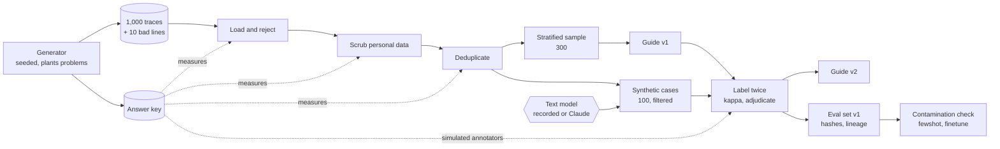

# Architecture: from raw traces to a trusted eval set

Component names match the lesson's diagram ("From raw traces to a trusted eval set"): **1,000 traces**, **Load and reject**, **Scrub personal data**, **Deduplicate**, **Label twice**, **Synthetic cases** and **Eval set v1**.

## Components and what each owns

| Component | Where it lives | What it owns |
| --- | --- | --- |
| **1,000 traces** (raw file and answer key) | generator [`application/generate_traces.py`](src/eval_set_builder/application/generate_traces.py), intents in [`application/intent_catalog.py`](src/eval_set_builder/application/intent_catalog.py), key type [`domain/answer_key.py`](src/eval_set_builder/domain/answer_key.py), files `data/raw/` | Writes 1,010 lines (1,000 traces and ten malformed lines) with 50 exact duplicates, 80 near-duplicates and personal data in 150 traces, and, in the same function, the answer key that says where each problem is. |
| **Load and reject** | [`domain/traces.py`](src/eval_set_builder/domain/traces.py), [`application/ingest.py`](src/eval_set_builder/application/ingest.py) | Validates each line on its own against the trace schema; a bad line is rejected with its 1-based line number and reason, and the other lines load. |
| **Scrub personal data** | [`domain/scrub.py`](src/eval_set_builder/domain/scrub.py), [`application/ingest.py`](src/eval_set_builder/application/ingest.py) | Typed placeholders (`<EMAIL_1>`) numbered per trace; measures the catch rate against the planted values and scans the output for any raw planted value. |
| **Deduplicate** | [`domain/dedup.py`](src/eval_set_builder/domain/dedup.py), [`application/dedupe_stage.py`](src/eval_set_builder/application/dedupe_stage.py) | Exact duplicates by hash of the normalized message; near-duplicates by word-shingle overlap with a setting chosen from a sweep over the planted pairs; keeps the earliest trace and records which trace absorbed each dropped one. |
| **Label twice** | [`domain/labels.py`](src/eval_set_builder/domain/labels.py), [`domain/guide.py`](src/eval_set_builder/domain/guide.py), [`domain/sampling.py`](src/eval_set_builder/domain/sampling.py), [`application/labeling_stage.py`](src/eval_set_builder/application/labeling_stage.py) | The stratified sample, guide version 1 written from sample cases, two independent passes, Cohen's kappa overall and per label, the confusion matrix, adjudication with a reason per disagreement, guide version 2. |
| **Synthetic cases** | [`domain/synthetic.py`](src/eval_set_builder/domain/synthetic.py), [`application/synthetic_seeds.py`](src/eval_set_builder/application/synthetic_seeds.py), [`application/synthetic_stage.py`](src/eval_set_builder/application/synthetic_stage.py), [`application/reference_assistant.py`](src/eval_set_builder/application/reference_assistant.py) | 120 seeds for six gaps; each generated message must be in the customer's voice, 4 to 80 words, name the asked-for order numbers, be in the asked-for language and stay below the near-duplicate threshold of every real and earlier synthetic case. The current assistant's reply and the rubric's true label are attached. |
| **Eval set v1** | [`application/freeze.py`](src/eval_set_builder/application/freeze.py), `eval-set/v1/` | `cases.jsonl`, `labels.jsonl`, the datasheet, both guide versions and a manifest of SHA-256 hashes, versions, settings, kappa and the lineage of every case back to its trace ids. |
| **Contamination check** | [`domain/contamination.py`](src/eval_set_builder/domain/contamination.py) | Compares eval text with `fewshot/` and `finetune/` using the same overlap measure that was tuned for deduplication. |
| **Text model** (port) | [`application/ports.py`](src/eval_set_builder/application/ports.py); adapters [`infrastructure/cassette.py`](src/eval_set_builder/infrastructure/cassette.py) (recorded) and [`infrastructure/claude_text_model.py`](src/eval_set_builder/infrastructure/claude_text_model.py) (Claude) | The only way the pipeline talks to a model. |
| **Annotators** (port) | `Labeler` and `Adjudicator` in `ports.py`; [`infrastructure/simulated_annotators.py`](src/eval_set_builder/infrastructure/simulated_annotators.py), [`application/model_labeler.py`](src/eval_set_builder/application/model_labeler.py), [`application/model_adjudicator.py`](src/eval_set_builder/application/model_adjudicator.py) | Who labels. Simulated by default, a model on request. |

## Pattern: a staged pipeline over a workspace, with ports for the model and the annotators

Each stage is a function of the named files before it, writes its output and a report, and is measured against the answer key. The stages talk to files through a `Workspace` port (a directory in production, a dictionary in tests), to the model through `TextModel`, and to annotators through `Labeler` and `Adjudicator`; `domain` holds the statistics (shingles, Jaccard, kappa, scrub measurement) and imports nothing outside the standard library. The reasons are in [ADR 0001](docs/adr/0001-measure-every-stage-against-an-answer-key.md) (why the answer key is written by the generator), [ADR 0002](docs/adr/0002-ports-for-the-model-and-the-annotators.md) (the ports) and [ADR 0003](docs/adr/0003-named-files-and-canonical-json.md) (why the stages exchange files and why the output is byte-reproducible). The dependency rule is enforced by import-linter in `make lint`.

## Data flow

### One run, step by step (`make run`)

1. `load` reads `data/raw/traces.jsonl` line by line. Ten lines fail with their numbers and reasons (`invalid JSON`, `missing fields: reply`, `field 'thumbs' must be...`) and 1,000 traces load. The rejected line numbers are compared with the key.
2. `scrub` replaces emails, phone numbers, street addresses and cue-introduced names in the history, message and reply of every trace, with one numbering per trace. The values it recorded are compared with the planted values; the output is scanned for any planted value still visible. The raw-value map goes to `work/` only (it is personal data and is git-ignored).
3. `dedup` drops traces whose normalized message hashes equal an earlier trace's, sweeps the near-duplicate settings (shingle size, threshold, digit guard) against the planted pairs, picks the best F1 and drops near-duplicates, keeping the earliest trace and writing the absorber of each drop to `work/dropped.jsonl`.
4. `sample-and-guide` draws 300 traces round-robin over the (intent, feedback) cells and writes guide v1 with one example and one counter-example per label taken from the sample.
5. `label` runs two independent passes, computes raw agreement, kappa (overall and per label) and the confusion matrix, sends each disagreement to the adjudicator for a final label and a reason, and writes guide v2 with the three most frequent confusions as rules.
6. `synthesize` renders `prompts/synthesize.v1.md` and each seed's instruction, calls the model, applies the filters, records every rejection with its rule, stops at 100 accepted cases, attaches the current assistant's reply and the rubric's label, and labels the slice the same way.
7. `compare` measures message length, vocabulary overlap, intent mix and pass rate for the two slices.
8. `contamination` checks every eval message against `fewshot/` and `finetune/`; `freeze` writes `eval-set/v1/` with canonical JSON, hashes every file and records lineage.

## Decisions and trade-offs

- **The generator writes the key.** A scrubber that "looks clean" and a deduplicator with a textbook threshold both fail silently; only a key written at plant time measures them. Cost: the sample is synthetic, so the measured rates describe this generator's problems, not your traffic. Mitigation: the same stage code runs on real traces; only the key is missing, and the reports then lack their measured columns.
- **Exact equality for the scrub measurement.** A planted value counts as caught only when the scrubber recorded exactly that string and none of it remains in the output. A pattern that eats a trailing period fails the exact match while the text still looks clean; this is the lesson's trap and `make run` shows it next to the fixed pattern.
- **Word shingles with an inverted index, not MinHash.** Exact Jaccard on short messages is simple and checkable against the planted pairs; the inverted index avoids the all-pairs scan. Past tens of thousands of traces MinHash with banding is the upgrade (the lesson's stretch, not built).
- **A digit guard on near-duplicates.** Templated questions that differ only in an order number have high overlap; requiring equal digit runs removes that class of false positive and is part of the swept settings, so its effect is a number in the report.
- **Round-robin stratified sampling.** One draw per (intent, feedback) cell in turn keeps a rare cell (a thumbs-down on a rare intent) in a 300-trace sample; proportional sampling would drop it.
- **Simulated annotators by default.** Two annotators with structured error and an adjudicator that knows the key let the whole pipeline, kappa and guide revision run offline. They are a stand-in for people; `LABELER=model` replaces them with model passes and a model adjudicator, and the label sheet interface is the place for human labels.
- **Authored sample cassette.** No key was available to record model replies, so the offline cassette is written by `scripts/author_synthetic_cassette.py` from templates (including wrong-voice and near-copy replies on purpose) and says so in its `provenance`. `make record-synthetic` overwrites it with real recordings keyed the same way.
- **Canonical output.** Sorted keys, no timestamps, ids assigned in time order: rebuilding from the same raw file and seed gives the same hashes, and a test and `make rebuild-check` prove it.

## Failure modes the lesson teaches, and where the code shows them

| Failure | Where it shows |
| --- | --- |
| A scrub that looks clean by eye but catches 89% (the greedy trailing-period pattern) | `reports/02-scrub.md` compares the fixed pattern with the first one; `tests/unit/domain/test_traces_and_scrub.py` pins the period case |
| A near-duplicate threshold from a textbook example is unsafe on templated traffic | the sweep table in `reports/03-dedup.md` and its "textbook default" line |
| 75% raw agreement hides how much is chance; one dominant label can give kappa 0 | `tests/unit/domain/test_dedup_labels_sampling.py` builds the 90% agreement / kappa 0.0 case; the report shows kappa per label |
| A synthetic case written in the wrong direction (the agent speaking) | the `voice` rule in `domain/synthetic.py`; five of the 111 calls in the sample cassette are rejected by it |
| A synthetic case that copies a real one | the `near_duplicate` rule; six rejections in the sample run |
| An accidental duplicate the key never recorded | the generator re-rolls collisions; `test_exactly_the_planted_exact_duplicates_collide_after_normalizing` checks the count |

## Limits of this teaching build against a production one

- The traces, answer key, annotators and adjudicator are simulated; a production build reads real traces, has no key, and measures the scrubber on a hand-labeled sample.
- Name detection is cue-based; a production scrubber adds an entity-recognition model and a review of the misses.
- All-pairs shingle scoring through an inverted index is fine for thousands of traces, not for millions.
- One machine, files on disk, no scheduler; a production pipeline runs weekly on new traces and alerts when the intent mix drifts (the lesson's stretch).

## How to extend it

- **Real traces:** point `WORKSPACE_ROOT` at a folder with your `data/raw/traces.jsonl` in the same schema and run `load`, `scrub`, `dedup` and `sample-and-guide`; skip the measured columns that need the key.
- **Real labels:** implement the `Labeler` protocol over a sheet, or use `LABELER=model`; keep the passes independent and the adjudicator a person.
- **MinHash:** replace `score_pairs` in `domain/dedup.py` with a banded MinHash that returns the same `ScoredPair` list; the sweep and report stay unchanged.
- **Active learning:** rank unlabeled traces by grader disagreement and feed the top 100 into `sample-and-guide` instead of the round-robin draw.
